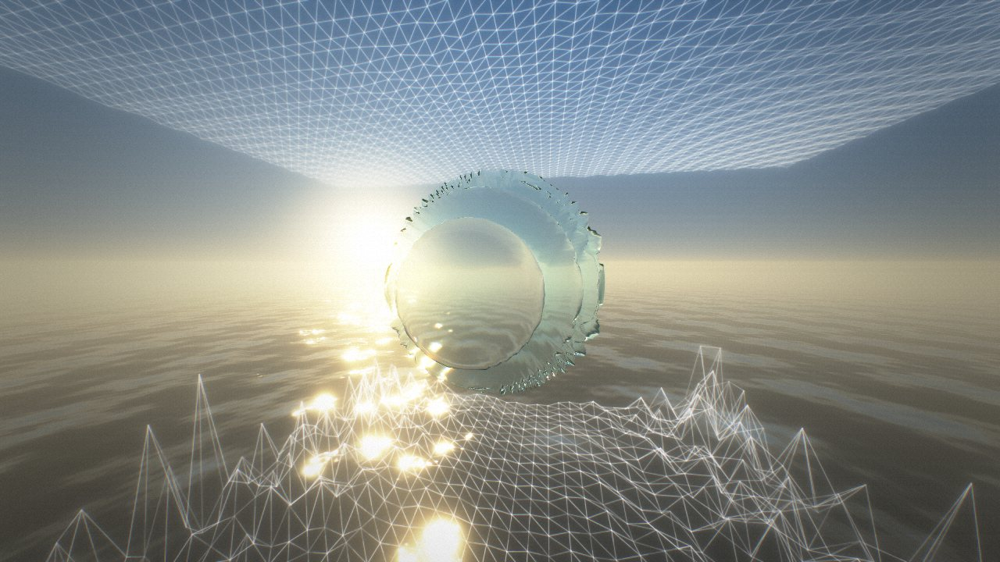
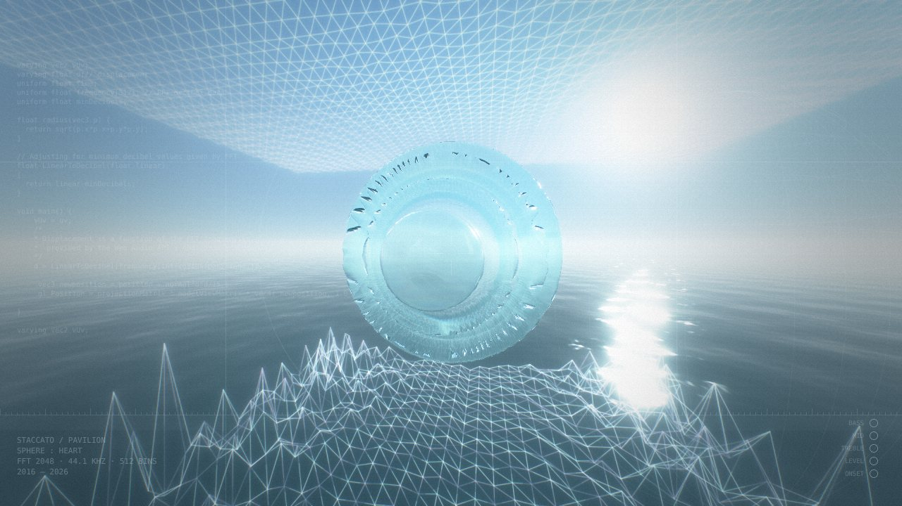
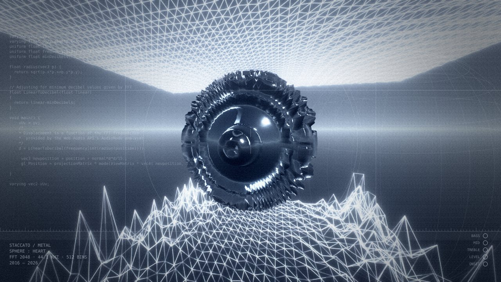
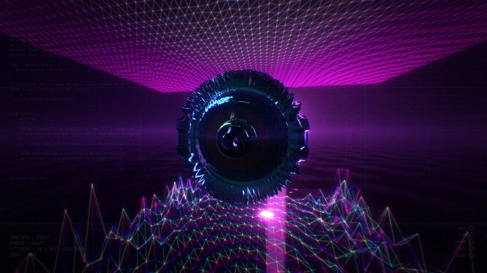
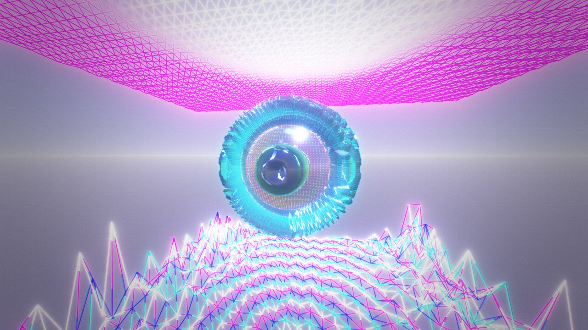

# Staccato



A WebGL music visualizer. Since 2016.

## About

A music visualizer experiment simply powered by shaders–which are programs that tell the GPU how to render the material its applied to–and audio Fourier transform data that can easily be accessed by the [Web Audio API](https://developer.mozilla.org/en-US/docs/Web/API/AnalyserNode).

Staccato simply takes data from a playing song, updates `uniforms`–which are variables that are passed into shaders for them to use–and now shapes in the scene using these shaders have tastefully modified vertices/color.

The two most important uniforms currently used include `time` and `frequency`, which is the elapsed time and a 32-bit float array for audio volume data, respectively. These two variables are alone enough to make powerful scenes, the beauty comes from simply how they're used in the shaders.

*— the original README, November 2016*

## Using it

Drop a song anywhere on the page. Or listen to the **mic**, to another browser **tab** (Spotify, YouTube, whatever's playing), or to the synthesized **demo**. Shapes are on the left and shaders are on the right: pick a shape, then pick a shader for it. Press `?` for all the keys.

| key | |
|---|---|
| `space` | play / pause |
| `o` `m` `t` `d` | file, microphone, tab audio, demo |
| `s` / `1`–`9` | select a shape / give it a shader |
| `c` | wire, chrome, chrome + wire, glass, glass + wire |
| `g` | generate a new shader |
| `e` | edit the selected shape's GLSL, live |
| `b` | look: origin, pavilion, metal, '16, night |
| `l` | frequency scale: log, or linear as in 2016 |
| `r` | record a clip (video + audio) |
| `h` / `f` | hide the interface / fullscreen |

The URL always describes the scene (`#sphere=heart&ceiling=echo&floor=sn-3fa9c&paper=night`), so sharing a link shares the scene, generated shaders included.

## Looks

One world (a sky, a sun, water, the three shapes), remembered five ways. Press `b`.

| | |
|---|---|
|  **origin.** The picture Staccato began as: white wires over the sea at dusk. The heart is the one new thing in an old memory, a glass bubble. |  **pavilion.** Glass architecture on a still morning: open blue, frosted panes, a mirror pool, pale steel. |
|  **metal.** Cold steel: a spiked chrome heart in a blue studio, read out like an instrument. The HUD shows the live GLSL and band meters. |  **night.** Black chrome over black water, neon horizon. |
|  **'16.** The 2016 lavender and the shaders' own hot colours. | |

## Writing shaders

Press `e`, or edit `src/shaders/*.vert|frag` under `npm run dev`. Shaders recompile as you type and the music keeps playing; errors point at your own line numbers.

GLSL in the 2016 style works unmodified (`varying`, `gl_FragColor`, `uniform float frequency[512]` read with `frequency[int(i)]`). The three originals in `src/shaders` are byte-for-byte the November 2016 files. Every shader gets:

| uniform / function | |
|---|---|
| `time` | seconds |
| `frequency(bin)` | dB of FFT bin 0–511 (int: exact, float: interpolated) |
| `minDecibels`, `maxDecibels`, `mDb`, `od` | the analyser's range; `od` is the mean dB of the frame |
| `spectrum(t)` | loudness 0–1 at position `t` along the spectrum |
| `echo(t, age)` | the same, `age` (0–1) up to ~2 seconds ago |
| `level`, `bass`, `mid`, `treble` | loudness 0–1 |
| `onset` | 1 on a note attack (spectral flux), decaying |
| `size`, `mouse`, `resolution` | shape radius / half-width; pointer; pixels |
| `position`, `normal`, `uv`, `modelViewMatrix`, `projectionMatrix`, … | as in three.js |

`window.staccato` is the running app, and it's an easily modifiable object. Try `staccato.generate(0x3fa9c)` or `staccato.assign('floor', 'echo')` from devtools.

## How it works

There's no engine: just TypeScript, WebGL2 and GLSL, with no runtime dependencies (about 25 kB gzipped).

- **Audio.** Sources feed an `AnalyserNode` (2048-point FFT, smoothed), which drives the shaders. A second, unsmoothed analyser feeds a spectral-flux onset detector. The spectrum is uploaded as a 512×1 float texture each frame, and a 512×128 ring buffer of recent spectra backs `echo()`.
- **Capture.** Each frame, every shape's vertex shader runs once per vertex as a point drawn into float textures: clip position in one, packed varyings in the rest, laid out like the mesh grid.
- **Wires.** Each edge is drawn as a screen-space quad of any width with analytic anti-aliasing, reading its endpoints from the capture. Your fragment shader colors it, unmodified.
- **World.** A procedural sky with a sun and horizon haze, softbox studio lights that pulse with the bass, and an ocean raytraced per pixel: filtered travelling waves, Fresnel reflection, sun glitter, and real depth, so ridges stand in the water. Wires and surfaces fade into distance fog.
- **Chrome and glass.** Normals are rebuilt from each vertex's displaced grid neighbours. Chrome is thin-film iridescent metal reflecting the world. Glass refracts a mipmapped snapshot of the frame behind it, frosted and split by wavelength, and a stencil pass keeps wires in front of it on top.
- **Post.** The scene renders into a 4× multisampled HDR target with a separate glow buffer. Then: dual-filter bloom, chromatic aberration that kicks on note attacks, per-look grading (duotone, lift, contrast, halation, soft focus toward the edges), a highlight shoulder, vignette, the HUD, and dithered grain.

Devices without float render targets fall back to plain `gl.LINES` (the 2016 look) without post-processing.

## Development

```sh
npm install
npm run dev        # http://localhost:5173, shaders hot-reload
npm run check      # typecheck + unit tests
npm run test:e2e   # real WebGL2 in headless Chromium
npm run build      # dist/
```

Pushes to `master` deploy to GitHub Pages through `.github/workflows/ci.yml`. In the repository settings, set **Pages → Source** to **GitHub Actions**.

## History

- **Oct 2016:** a wireframe plane with a simplex-noise shader, then a wave, then an abyss, Pizzicato.js, and the FFT. *"It's now a pretty wave :)"*
- **Nov 2016:** the heart, drag and drop, the mouse-following camera. The scene in the screenshot above.
- **Dec 2016 – Mar 2017:** the shader sidebar and a procedural shader generator.
- **2021 – 2023:** TypeScript, webpack, three r149, OrbitControls, GitHub Pages.
- **2026:** hand-written WebGL2, anti-aliased wires, chrome and glass, the ocean from the original concept, five looks, onsets, mic and tab capture, a live editor, seeded generator, recording.

MIT © Anwar Ali-Ahmad
